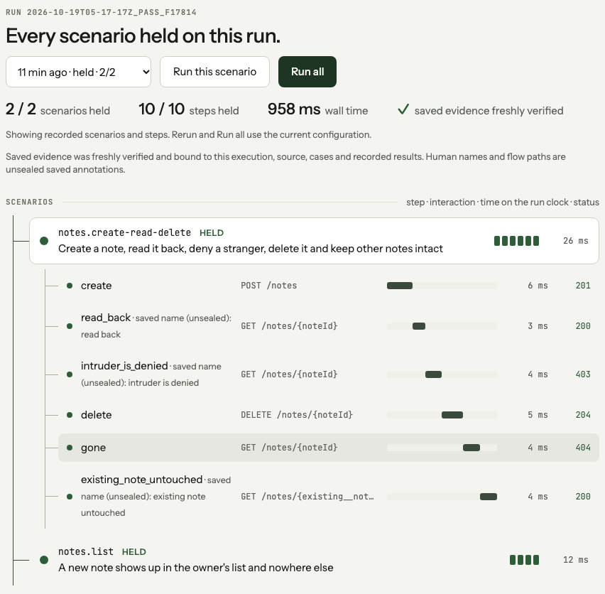

<div align="center">

# tracegrove

**End-to-end tests that check what your app actually did, not just what it said.**

[](LICENSE)
[](https://www.npmjs.com/package/tracegrove)
[](#requirements)

[Quickstart](#quickstart) · [Voice and chat agents](#voice-agents-and-chatbots) · [Readiness and handoff](#readiness-sign-off-and-client-handoff) · [Security](#security-and-client-data) · [Docs](#documentation)

</div>

---

Tracegrove launches your app (or points at a deployed one), drives it the way a user would, and then **reads the result back separately** to confirm the change really happened. Every run leaves evidence on disk that anyone can re-verify later without rerunning the app.

It is built for the bugs that pass ordinary tests: the booking your voice agent confirmed but never saved, the delete that returned `204` but left the row, the record a stranger can still read.

```yaml
# tracegrove/notes/create-read-delete.flow.yaml
steps:
  - name: create
    POST: /notes
    json: { title: Fresh note }
    expect: { status: 201 }
    save: { noteId: note.id }
  - name: read back           # a separate request proves the write landed
    GET: /notes/{noteId}
    observe: true
    expect: { status: 200, json: { note.title: Fresh note } }
  - name: intruder is denied  # same note, different persona
    GET: /notes/{noteId}
    as: intruder
    expect: { status: 403, absent: [note] }
```

## What it can test

| Surface | How | Start with |
| --- | --- | --- |
| **HTTP APIs** (Node, FastAPI, Django) | real requests as test personas, independent readbacks, cleanup checks | `sample-config --sample notes-api` |
| **Voice agents** | talks to the agent over RTVI (the Pipecat protocol), checks what it said and which tools it called, then reads your backend | `--sample voice-receptionist` |
| **Chatbots** | multi-turn HTTP chat with the same checks | `--sample support-chatbot` |
| **Web UIs** | Playwright Chromium steps paired with an API readback, with recordings | `--sample notes-browser` |
| **MCP servers** | tool calls over Streamable HTTP | `--sample notes-mcp` |
| **Background jobs** | native job runners and their outputs | `--sample report-jobs` |
| **Deployed environments** | the same flows against Docker, staging or read-only production, with credentials from your secret store | [environments](docs/environments.md) |

And around every run:

- **Readiness**: each flow is a claim with four separate answers (did it run, what the evidence supports, whether it is still current, who signed off), so "green" can't hide a stale or unreviewed result.
- **Client handoff**: one HTML report with transcripts, readbacks and sign-offs that you can send to a client.
- **Privacy**: phone numbers, emails, cards and your own patterns are redacted before anything is written; runs can be sealed with AES-256-GCM.
- **Agent-friendly**: every command has `--json`, stable exit codes, and an MCP server (`tracegrove mcp`). Claude Code or Codex can draft and repair flows, but can never quietly weaken a check.

## Quickstart

### Requirements

Node.js 22 (`>=22.22.0 <23`), npm, a POSIX shell and local loopback. The Notes sample needs no Docker, browser, Python or cloud account. Windows is not supported in 0.x.

```bash
mkdir tracegrove-demo && cd tracegrove-demo
npm init -y
npm install --save-dev --save-exact tracegrove
```

Then run this block in the same directory. It writes a synthetic Notes API with in-memory test personas, checks the flows, runs two scenarios, and verifies the saved evidence:

<!-- onboarding-quickstart:start -->
```bash
set -euo pipefail
TRACEGROVE_CLI="${TRACEGROVE_CLI:-$PWD/node_modules/tracegrove/dist/cli/main.js}"
TRACEGROVE_DEMO="$(mktemp -d "$PWD/tracegrove-notes-XXXXXX")"
node "$TRACEGROVE_CLI" sample-config --sample notes-api --output "$TRACEGROVE_DEMO"
node "$TRACEGROVE_CLI" doctor --config "$TRACEGROVE_DEMO/verification/workflow.yaml" --json
node "$TRACEGROVE_CLI" check --dir "$TRACEGROVE_DEMO" --json
node "$TRACEGROVE_CLI" test --config "$TRACEGROVE_DEMO/tracegrove.config.yaml" --json | tee "$TRACEGROVE_DEMO/run.json"
TRACEGROVE_RUN="$(node -p 'JSON.parse(require("node:fs").readFileSync(process.argv[1],"utf8")).runDir' "$TRACEGROVE_DEMO/run.json")"
node "$TRACEGROVE_CLI" verify-bundle --bundle "$TRACEGROVE_RUN/bundle" --json
printf 'Evidence retained at %s\n' "$TRACEGROVE_RUN"
```
<!-- onboarding-quickstart:end -->

Success looks like `doctor` → `blocked: false`, `check` → `ok: true`, `test` → `outcome: passed` with `bundleVerified: true`, and `verify-bundle` → `ok: true`. Open the results with `node "$TRACEGROVE_CLI" ui --dir "$TRACEGROVE_DEMO"`, or read `$TRACEGROVE_RUN/summary.md`.



> **Try breaking it.** In a copy of the sample, change the final `gone` step to expect `200` and rerun `test`. It fails with an assertion error and keeps the failed run so you can inspect it.

### Use it on your own app

```bash
npm install --save-dev --save-exact tracegrove
npx --no-install tracegrove init     # writes tracegrove.config.yaml and a starter flow
npx --no-install tracegrove check    # compile flows without starting the app
npx --no-install tracegrove test     # launch the app, run flows, save evidence
npx --no-install tracegrove ui       # browse runs locally
```

`init` picks an adapter (`node`, `fastapi`, `django`) and writes a config like this. Review it, especially the health route and personas:

```yaml
project: notes
app:
  adapter: node
  entry: server.js
  health: /health
  inject: { port: PORT, dataDir: NOTES_DATA_DIR, tokens: TRACEGROVE_TOKENS }
personas:
  owner:    { subject: user-1 }
  intruder: { subject: user-2 }
```

Your app gets a fresh data directory and a set of test persona tokens on every run. It needs a test-only way to accept those tokens; keep that path off in production. Flows live at `tracegrove/<area>/<behavior>.flow.yaml`. See [Getting started](docs/getting-started.md).

## Voice agents and chatbots

A voice step holds a real conversation with your agent and checks the reply on every turn. The readback after it checks your backend.

```yaml
title: A caller books a cleaning by phone, and the booking really exists
risk: critical
steps:
  - name: caller books a cleaning
    as: none
    voice:
      endpoint: /voice
      turns:
        - say: Hi, I'd like to book a cleaning on Tuesday at 3pm.
          expect: { says: [cleaning, Tuesday, 3 PM], noCalls: [book_appointment], within: 1500 }
        - say: Sure, my name is Dana Lee and my number is 555-0142.
          expect: { says: [all set, confirmation number], calls: [book_appointment] }
    save: { appointmentId: "toolCalls[0].result.appointment.id" }
  - name: front desk sees the booking
    GET: /appointments/{appointmentId}
    observe: true
    expect: { status: 200, json: { appointment.status: booked, appointment.patient: Dana Lee } }
```

```bash
npx --no-install tracegrove sample-config --sample voice-receptionist --output ./voice-demo
npx --no-install tracegrove test --config ./voice-demo/tracegrove.config.yaml
```

Turn on the sample's `RECEPTIONIST_BUG=drop_booking` and the agent still says "You're all set", but the run fails at **front desk sees the booking: status 404 != 200**.


- **Voice** speaks [RTVI](https://docs.pipecat.ai/client/rtvi-standard) over WebSocket, so Pipecat bots work as is. Other platforms can expose a text test endpoint that drives the same agent and tools.
- **Chat** posts `{ message, sessionId }` and reads `reply` and `toolCalls`; every field name is configurable.
- Checks: `says`, `notSays`, `calls`, `noCalls`, `within` (ms to first reply), per turn or for the whole conversation.
- Text injection skips speech recognition, audio and telephony. It tests the agent's decisions and their effects, which is where most failures are.

Full guide: [docs/voice-and-chat.md](docs/voice-and-chat.md).

## Readiness, sign-off and client handoff

```bash
npx --no-install tracegrove readiness                 # every flow as a claim; exits 0 only when all are ready
npx --no-install tracegrove accept calls.books-a-cleaning --reason "Reviewed transcript and readback"
npx --no-install tracegrove handoff --client "Bright Smile Dental"
```


Routine claims are accepted automatically once the evidence supports them. Claims marked `risk: critical` need a person. A sign-off is bound to the exact check and code it saw: change either and the claim asks again. You can `waive`, `reject` or `challenge` a claim with a reason, but nothing loosens a check silently. Decisions are saved in `tracegrove/decisions.yaml` next to your flows.

`handoff` writes one self-contained HTML page with every claim, transcript, readback and sign-off, plus an honest "what this does not cover" section. Details: [docs/readiness-and-handoff.md](docs/readiness-and-handoff.md).

## Security and client data

- **Runs locally.** No tracegrove server, account or telemetry. Evidence stays on your disk.
- **Credentials are references.** The config says where a secret lives (`env:`, `file:`, `aws-sm://`, `aws-ssm://`, `op://`); the value is resolved at run time, held in memory, sent only as an `Authorization` header, and scrubbed from anything written.
- **Client data can be redacted** before it is saved:

  ```yaml
  privacy:
    redact: [phone, email, card, ssn, { name: member_id, pattern: "MBR-[0-9]{6}" }]
  ```

- **Runs can be encrypted at rest** with `tracegrove seal --run latest --out run.tgseal --remove` (AES-256-GCM, key from `TRACEGROVE_SEAL_KEY`).

Full details and limits: [docs/security.md](docs/security.md). To report a vulnerability, see [SECURITY.md](SECURITY.md).

## Environments

The same flows run against local, Docker, staging or production. Each environment says where persona credentials come from and what a run may write. On staging, a run whose cleanup can't be confirmed fails; under `production_observation`, any flow that writes is blocked before it starts.

```yaml
environments:
  staging:
    target: { url: https://staging.example.com, health: /api/health }
    personas:
      owner:    { from: "aws-sm://myapp/staging/personas#owner" }
      stranger: { from: "op://Engineering/myapp-staging/stranger-token" }
```

```bash
npx --no-install tracegrove env doctor staging   # reachable, secrets resolve, personas are who you think
npx --no-install tracegrove test --env staging
```

See [docs/environments.md](docs/environments.md).

## For coding agents and CI

Every command takes `--json`. `status --json` says what to do next; `test --json` returns a `tracegrove.run-summary/v1` with `outcome`, `runDir`, `bundleVerified`, `cases` and `blockers`. `tracegrove mcp` exposes the same commands over MCP.

| Exit | Meaning |
| --- | --- |
| `0` | Passed or clean |
| `1` | Assertion failed |
| `2` | Blocked or inconclusive (fix setup, don't retry blindly) |
| `3` | Infrastructure failed |
| `4` | Cancelled |

`draft` asks Claude Code or Codex to write flows; `heal` asks it to repair them. Both may edit files, so commit first and review the diff. An agent may tighten a flow or challenge a check, but it never weakens an assertion to get green.

[Agent guide](docs/agent-guide.md) · [Verified bundles](docs/verified-bundles.md) · [Browser driver](docs/browser-driver.md) · [MCP driver](docs/mcp-driver.md) · [Native jobs](docs/native-jobs.md)

## Where it runs

| Placement | Status |
| --- | --- |
| macOS | The Notes sample passes on a Mac. Broader qualification is open. |
| Linux CI | The repository's Ubuntu CI runs the Node, FastAPI, Django, browser, voice/chat and evidence lanes. |
| Cloud sandboxes (Codex, Claude Code on the web) | Works where local child processes, loopback and writable storage are allowed. There is no hosted runner. |
| Windows | Not supported in 0.x. |

## Documentation

| Guide | What it covers |
| --- | --- |
| [Getting started](docs/getting-started.md) | Adding tracegrove to your app |
| [Voice and chat](docs/voice-and-chat.md) | Conversation steps, transports, checks |
| [Readiness and handoff](docs/readiness-and-handoff.md) | Claims, sign-off, client reports |
| [Security](docs/security.md) | Credentials, redaction, sealed runs |
| [Environments](docs/environments.md) | Docker, staging, production, secret stores |
| [Agent guide](docs/agent-guide.md) | JSON contracts for coding agents |
| [Verified bundles](docs/verified-bundles.md) | What the evidence proves and doesn't |
| [Architecture](docs/architecture.md) | The compiler, planner, executor and reducer |

## Contributing

Issues and pull requests are welcome. See [CONTRIBUTING.md](CONTRIBUTING.md) for setup and the test commands, and [CODE_OF_CONDUCT.md](CODE_OF_CONDUCT.md).

## License

[Apache-2.0](LICENSE)
