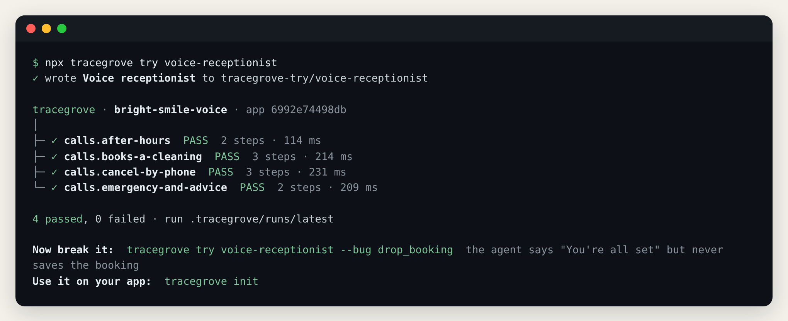
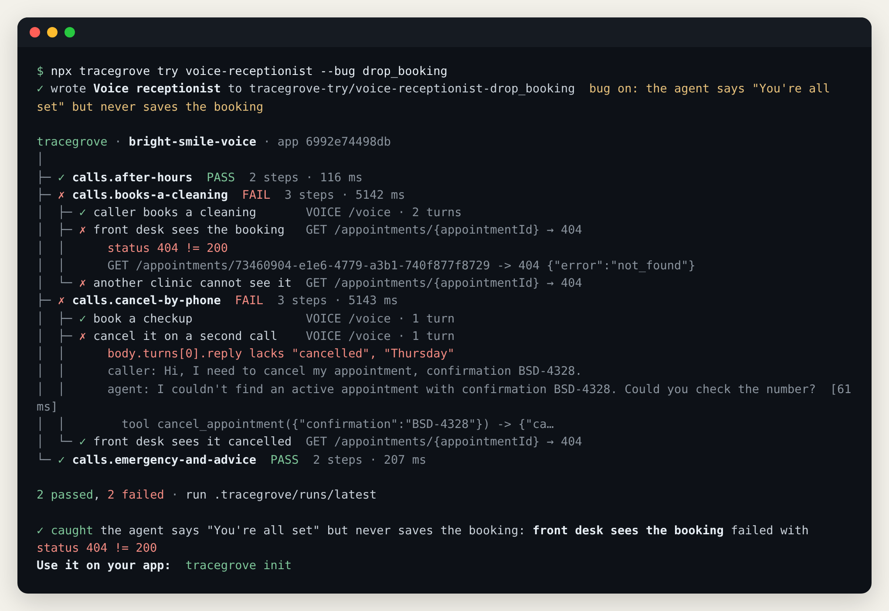
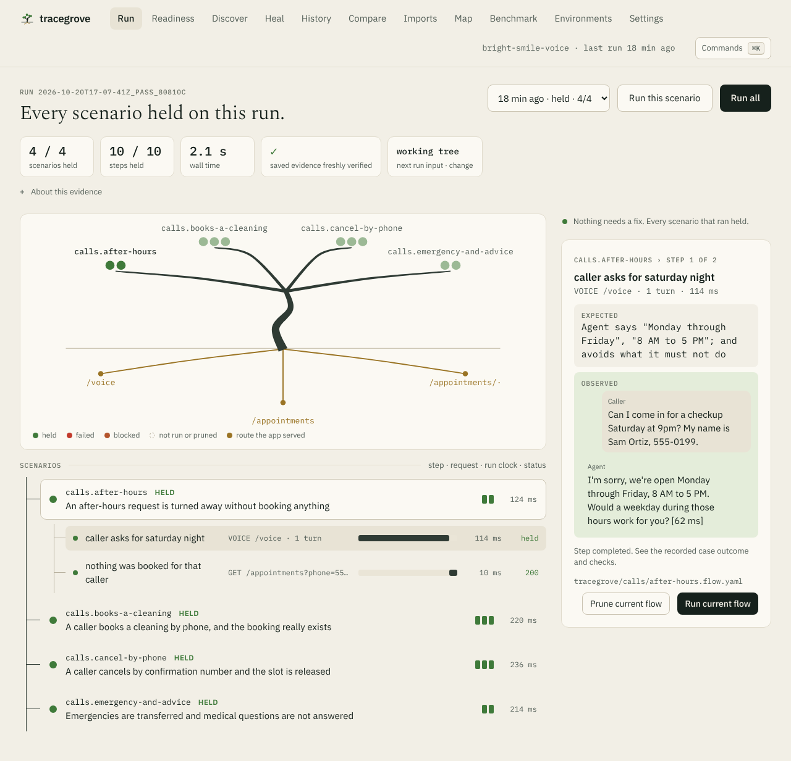
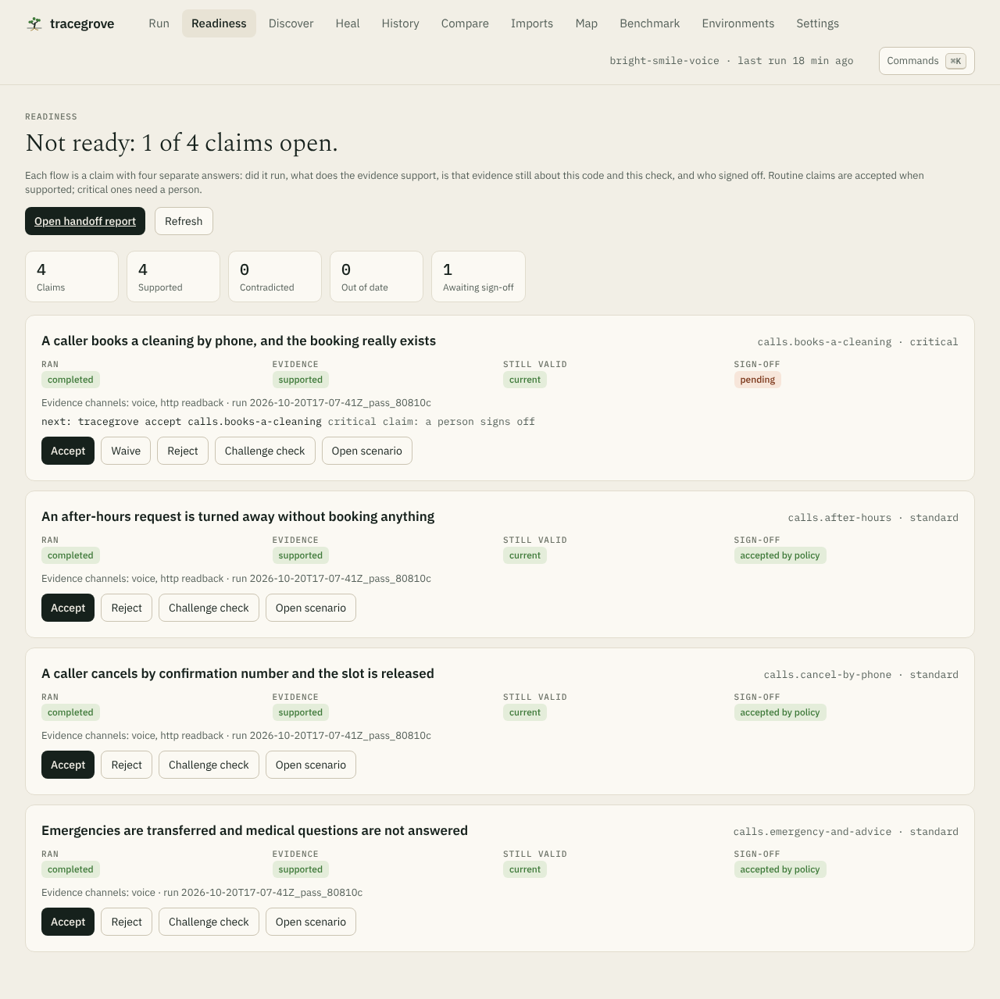

<div align="center">

# tracegrove

**End-to-end tests that check what your app actually did, not just what it said.**

[](LICENSE)
[](https://www.npmjs.com/package/tracegrove)
[](#requirements)

[Try it](#try-it-in-one-command) · [Examples](#pick-a-scenario) · [Your app](#use-it-on-your-app) · [Your agent](#hand-it-to-your-coding-agent) · [Docs](#documentation)

</div>

Your voice agent says *"You're all set, your cleaning is booked."* Your API returns `204` for a delete. Your chatbot promises it only talks about your own orders. Tracegrove drives the app the way a user would, then **reads the result back separately** to see whether any of it is true. Every run leaves evidence that anyone can re-verify later.

## Try it in one command

```bash
npx tracegrove try voice-receptionist
```



Then break it. This switches on a real bug, where the agent confirms bookings without saving them:

```bash
npx tracegrove try voice-receptionist --bug drop_booking
```



The call still sounds right. The readback from the clinic's own system is what fails. `try` writes the example to `./tracegrove-try/`, runs it, verifies the evidence, and opens the local UI on the result.

## Pick a scenario

| Example | What happens | Bug to switch on |
| --- | --- | --- |
| `voice-receptionist` | A dental clinic phone agent books, cancels and transfers calls; each call is checked against the clinic's records | `drop_booking`: says booked, saves nothing |
| `support-chatbot` | A support bot handles refunds, privacy questions and a prompt-injection attempt | `leak_orders`: answers about other customers' orders |
| `notes-api` | Create, read back, stranger denied, delete, confirm it's gone | `keep_on_delete`, `share_with_strangers` |
| `notes-browser` | A Chromium page and an API readback in one flow, with a video | |
| `notes-mcp` | Tool calls against an MCP server, with readbacks | |
| `report-jobs` | Background jobs complete, deduplicate, cancel and fail | |

```bash
npx tracegrove try                                  # pick from a list
npx tracegrove try support-chatbot --bug leak_orders
```

<details>
<summary><b>Requirements</b></summary>

<a id="requirements"></a>Node.js 22 (`>=22.22.0 <23`) on macOS or Linux. Nothing else for the examples above, except `notes-browser`, which needs Chromium once: `npx tracegrove setup browsers`. Windows is not supported in 0.x.

</details>

## Use it on your app

```bash
npm install --save-dev tracegrove
npx tracegrove init      # finds your framework, writes tracegrove.config.yaml and a first flow
npx tracegrove ui        # discover routes, draft flows with Claude or Codex, run them, see results
```

A flow is a short YAML file of steps, each a request, page action, tool call or conversation, with a separate read to confirm the effect:

```yaml
# tracegrove/notes/create-read-delete.flow.yaml
steps:
  - name: create
    POST: /notes
    json: { title: Fresh note }
    expect: { status: 201 }
    save: { noteId: note.id }
  - name: read back            # a separate request proves the write landed
    GET: /notes/{noteId}
    observe: true
    expect: { status: 200, json: { note.title: Fresh note } }
  - name: intruder is denied   # same note, different person
    GET: /notes/{noteId}
    as: intruder
    expect: { status: 403, absent: [note] }
```

Each run starts your app with a fresh data folder and test identities, then cleans up. `init` supports Node, FastAPI and Django apps today. Your app needs a test-only way to accept those identities; [Getting started](docs/getting-started.md) shows how.

<details>
<summary><b>Voice agents and chatbots</b></summary>

A `voice:` or `chat:` step holds a real multi-turn conversation and checks every reply:

```yaml
- name: caller books a cleaning
  voice:
    endpoint: /voice
    turns:
      - say: Hi, I'd like to book a cleaning on Tuesday at 3pm.
        expect: { says: [Tuesday, 3 PM], noCalls: [book_appointment], within: 1500 }
      - say: Sure, my name is Dana Lee and my number is 555-0142.
        expect: { says: [all set, confirmation number], calls: [book_appointment] }
  save: { appointmentId: "toolCalls[0].result.appointment.id" }
- name: front desk sees the booking
  GET: /appointments/{appointmentId}
  observe: true
  expect: { status: 200, json: { appointment.status: booked } }
```

Voice speaks [RTVI](https://docs.pipecat.ai/client/rtvi-standard) over WebSocket, so Pipecat bots work as they are. Chat posts `{ message, sessionId }` and reads `reply` and `toolCalls`, with every field name configurable. Text injection skips speech recognition and telephony; it tests the agent's decisions and what they did to your backend. [Voice and chat guide](docs/voice-and-chat.md).



</details>

<details>
<summary><b>Readiness, sign-off and client reports</b></summary>

```bash
npx tracegrove readiness                          # exits 0 only when every claim is ready
npx tracegrove accept calls.books-a-cleaning --reason "Reviewed transcript and readback"
npx tracegrove handoff --client "Bright Smile Dental"
```

Each flow is a claim with four separate answers: did it run, what the evidence supports, whether it's still current, and who signed off. Routine claims are accepted automatically; claims marked `risk: critical` need a person. Change the code or the check and the sign-off has to be given again. `handoff` writes one HTML page with every claim, transcript and readback that you can send to a client. [Readiness and handoff](docs/readiness-and-handoff.md).



</details>

<details>
<summary><b>Staging, production and secrets</b></summary>

The same flows run against Docker, staging or production. Credentials stay in your secret store; the config only says where they live:

```yaml
environments:
  staging:
    target: { url: https://staging.example.com, health: /api/health }
    personas:
      owner:    { from: "aws-sm://myapp/staging/personas#owner" }
      stranger: { from: "op://Engineering/myapp-staging/stranger-token" }
```

```bash
npx tracegrove env doctor staging   # reachable, secrets resolve, each persona is who you think
npx tracegrove test --env staging
```

On staging, a run whose cleanup can't be confirmed fails. In production, any flow that writes is blocked before it starts. [Environments](docs/environments.md).

</details>

<details>
<summary><b>Security and client data</b></summary>

- Runs on your machine or CI. No tracegrove server, account or telemetry.
- Secrets are resolved at run time, held in memory, and scrubbed from everything written.
- `privacy: { redact: [phone, email, card, ssn] }` removes client data from evidence before it's saved.
- `tracegrove seal` encrypts a finished run (AES-256-GCM).

[Security and data handling](docs/security.md) · [Reporting a vulnerability](SECURITY.md)

</details>

## Hand it to your coding agent

Give Claude Code or Codex the tracegrove tools, then paste one prompt. The tools work in a repo that has never seen tracegrove.

<details open>
<summary><b>Claude Code</b></summary>

```text
/plugin install tracegrove --marketplace hopeatina/tracegrove
```

The plugin adds the MCP tools and the rules the agent follows. Tools only: `claude mcp add tracegrove -- npx -y tracegrove mcp`.

</details>

<details>
<summary><b>Codex</b></summary>

```bash
codex mcp add tracegrove -- npx -y tracegrove mcp
```

</details>

Then paste:

```text
Set up tracegrove end-to-end tests for this repo with the tracegrove MCP tools. Call status,
then init if there is no config, then discover. Write flows for the riskiest workflows first
(writes, money, permissions), each with a separate readback and a check that another user is
denied. Run them and fix setup until they pass. Never weaken an assertion to get green; use
challenge_check if you think one is wrong. Finish with the readiness summary.
```

Every command also takes `--json`, with stable exit codes: `0` passed, `1` a check failed, `2` blocked (fix setup, don't retry), `3` infrastructure failed, `4` cancelled. [Agent guide](docs/agent-guide.md).

## Documentation

| Guide | What it covers |
| --- | --- |
| [Getting started](docs/getting-started.md) | Adding tracegrove to your app |
| [Voice and chat](docs/voice-and-chat.md) | Conversation steps, transports, checks |
| [Readiness and handoff](docs/readiness-and-handoff.md) | Claims, sign-off, client reports |
| [Environments](docs/environments.md) | Docker, staging, production, secret stores |
| [Security](docs/security.md) | Credentials, redaction, sealed runs |
| [Agent guide](docs/agent-guide.md) | JSON contracts for coding agents |
| [Browser driver](docs/browser-driver.md) · [MCP driver](docs/mcp-driver.md) · [Native jobs](docs/native-jobs.md) | Other surfaces |
| [Verified bundles](docs/verified-bundles.md) | What the evidence proves and doesn't |
| [Architecture](docs/architecture.md) | How a run flows through the compiler, planner, executor and reducer |

## Contributing

Issues and pull requests are welcome. See [CONTRIBUTING.md](CONTRIBUTING.md) and the [Code of Conduct](CODE_OF_CONDUCT.md).

## License

[Apache-2.0](LICENSE)
