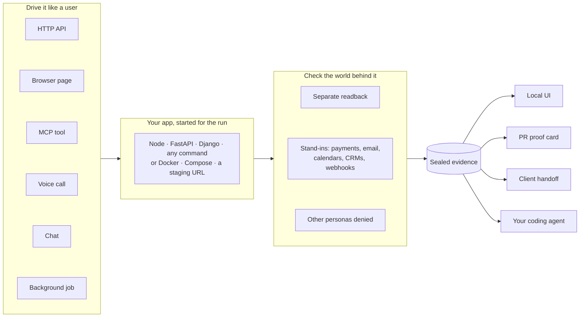

<div align="center">

# tracegrove

**End-to-end tests for your whole stack that check what actually happened.**<br>
Built from reusable steps, replayable from sealed evidence, and written and repaired by your coding agent.

[](LICENSE)
[](https://www.npmjs.com/package/tracegrove)
[](#requirements)

[What's different](#whats-different) · [The whole stack](#one-flow-the-whole-stack) · [Reusable](#reusable-steps-not-copy-paste) · [Replayable](#every-run-is-replayable-evidence) · [Agent native](#agent-native) · [Try it](#try-it-in-one-command) · [Docs](#documentation)

</div>

Most tests check what one layer said back. A unit test checks a function's return value. A Playwright test checks a page. A Postman check checks one response. None of them asks whether the work really happened across the rest of your stack: the row in the database, the charge at the payment provider, the email that went out, the record another customer must not see.

Tracegrove drives your app through its real front doors (an API, a browser page, an MCP tool, a phone call or a chat). Then it **reads the result back separately**, at every layer the action touched. A flow is a few lines of YAML that you, or your coding agent, write once. Flows are composed from reusable actions, run unchanged on your laptop, in Docker, on staging or read-only in production, and leave a sealed record that anyone can re-verify later.

```bash
npx tracegrove try        # nine working examples, from a voice receptionist to SaaS billing; add --bug <name> to watch one get caught
```

## What's different

| | Unit and integration tests<br><sub>Jest, pytest, supertest</sub> | Browser end-to-end<br><sub>Playwright, Cypress</sub> | API tools<br><sub>Postman, Hurl</sub> | **tracegrove** |
| --- | --- | --- | --- | --- |
| What is checked | A function or one response | What the page shows | One response at a time | **The effect**: a separate readback from your backend, plus what your app sent to payments, email or webhooks |
| Who else is tested | Usually nobody | Usually one logged-in user | Whoever owns the token | **Every persona**: a stranger, another tenant or a revoked user is denied in the same flow |
| Surfaces in one test | One | Browser | HTTP | **HTTP, browser, MCP tools, voice, chat and background jobs** in one flow |
| Third-party services | Mocked by hand in code | Out of scope | Real or nothing | **Stand-ins** that record what your app sent and can fail, stall or replay on cue |
| Where it runs | In-process | Against any URL | Against any URL | **Same flow** locally, in Docker or Compose, on staging, and read-only in production, each with its own safety rules |
| Clean-up | Your problem | Your problem | Your problem | **Tracked for every resource a flow creates**; on staging, a run whose clean-up can't be confirmed fails |
| What a run leaves | Pass/fail in a log | Traces and videos | A report | **A sealed, hash-chained bundle** anyone can re-verify, compare and hand to a client |
| Who writes and fixes it | You | You, or a recorder | You | **Your coding agent too**: it discovers the riskiest untested routes, drafts flows, proves them by running them, and heals drift without weakening a check |

Tracegrove doesn't replace your unit tests or your Playwright suite. It covers what they leave out, which is whether a user-visible action did the right thing to everything behind it.

## One flow, the whole stack



This flow comes from the `saas-billing` example. A card decline is injected at the payment provider. The flow then checks the plan didn't change in the database, the billing contact got exactly one email, and no invoice was issued:

```yaml
# tracegrove/billing/card-declined.flow.yaml
title: A declined card keeps the old plan, flags the account and emails the billing contact
risk: critical
steps:
  - name: the processor declines the card
    standin: payments
    fail: { route: POST /v1/charges, status: 402, times: 1 }
  - name: owner tries to upgrade
    POST: /subscription
    json: { plan: team }
    expect: { status: 402, json: { error: payment_failed } }
  - name: the plan didn't change          # a separate read, not the response above
    GET: /account
    observe: true
    expect: { status: 200, json: { account.plan: starter, account.dunning: true } }
  - name: the billing contact got one payment-failed email
    standin: email
    received: POST /send
    expect: { calls: 1, json: { "calls[0].json.template": payment_failed } }
  - name: no invoice was issued
    GET: /invoices
    observe: true
    expect: { status: 200, json: { invoices: [] } }
```

| Layer | What tracegrove supports |
| --- | --- |
| **How a flow drives the app** | HTTP requests · Chromium page actions with video · MCP tool calls · voice calls over RTVI (Pipecat) · HTTP chat · native background jobs |
| **How the app is started** | Node, FastAPI and Django detected by `init` · any start command · Docker image · Docker Compose · an already deployed URL (preview, staging, production) |
| **Services your app calls** | `standIns:` record every request to payments, email, calendars, CRMs and automation webhooks, and inject failures, stalls and webhook replays |
| **Who is acting** | Named personas per flow (`as: intruder`); secrets from env vars, files, AWS Secrets Manager, 1Password or a test-persona broker, never written to disk |
| **Where results go** | Local UI · `--json` / `--jsonl` for scripts and agents · a proof card on every pull request · a client-ready HTML handoff · an encrypted, sealed archive |
| **Evidence you already have** | `import-observations` keeps Playwright JSON and JUnit XML reports beside tracegrove's own, clearly marked as imported |

## Reusable steps, not copy-paste

Any sequence of steps can become an **action**: a file with inputs and outputs that flows call with `use:`. Actions can call other actions. They expand into ordinary steps when flows are compiled, so a step inside an action is executed, checked and sealed like any hand-written one.

```yaml
# tracegrove/actions/billing/upgrade.action.yaml  →  the action billing.upgrade
title: Upgrade the account and confirm it stuck
inputs: { plan: team }
outputs: [invoiceId]
routes: [POST /subscription, GET /account]
steps:
  - name: upgrade
    POST: /subscription
    json: { plan: "{plan}" }
    expect: { status: 200 }
    save: { invoiceId: invoice.id }
  - name: the plan changed
    GET: /account
    observe: true
    expect: { status: 200, json: { account.plan: "{plan}" } }
```

```yaml
# tracegrove/composed/invoice-privacy.flow.yaml
title: An invoice from an upgrade is private to its account
steps:
  - use: billing.upgrade
    with: { plan: team }
  - name: the other tenant can't see it
    GET: /invoices/{invoiceId}
    as: other_tenant
    expect: { status: 404, absent: [invoice] }
```

- **One flow, many places.** `tracegrove test --env staging` runs the same files against staging with staging's personas. Flows that write are refused in production before they start.
- **One flow, many people.** `as:` swaps the persona on any step, so "the owner can and the stranger can't" is two lines, not two test files.
- **What's learned is kept.** `discover --save` writes `tracegrove/catalog.yaml`: every route, the file that handles it, the actions that reach it and the run that confirmed it. A fresh clone, a teammate and the next agent all start from there, not from scratch.

## Every run is replayable evidence

Every run writes a bundle under `.tracegrove/runs/<run>/`: the frozen request, each step's observation, the app's source digest and a hash chain over all of it.

```bash
npx tracegrove verify-bundle --bundle .tracegrove/runs/<run>/bundle   # re-derive the verdict from the bytes
npx tracegrove compare --baseline <old>/bundle --candidate <new>/bundle
npx tracegrove rerun --request <request.json> --output <new.json>     # a fresh attempt on the same frozen cases
npx tracegrove handoff --client "Acme"                               # one HTML page with every claim and readback
npx tracegrove seal --run latest --out run.sealed                    # encrypt it to send or archive
```

- **Re-verify instead of trusting a green tick.** A reviewer, a client or CI can recheck a run without rerunning your app.
- **Compare across commits.** `compare` lines up two verified runs case by case and says what changed: outcome, contract or selection.
- **Know when evidence is stale.** Each claim records the source it ran against. Change the code or the check and its sign-off has to be given again (`tracegrove readiness`).
- **Watch it back.** Browser steps keep a video, voice and chat steps keep the full transcript with tool calls, and the UI's History tab shows every scenario across every run.

## Agent native

Tracegrove was built for coding agents to drive. The person reviews the evidence.

- **An MCP server that works before setup.** `tracegrove mcp` gives Claude Code, Codex or any MCP client `status`, `init`, `discover`, `draft`, `test`, `heal`, `readiness`, `challenge_check` and environment tools. It works in a repo that has never seen tracegrove.
- **Risk-ranked discovery.** `discover` reads routes from code, the catalog and traffic the app actually served. It lists the riskiest untested ones first: writes, money, permissions and personal data.
- **Drafts are proven, not just written.** `draft` has Claude Code or Codex write flows. Tracegrove checks them, runs each one end to end and sends failures back for up to two repairs. A draft that never passed is never presented as done.
- **Heal without cheating.** `heal` fixes setup mistakes and drifted tests, keeps only fixes that pass on re-run, and reports real product bugs instead of editing them away. An agent that disagrees with a check files `challenge_check`, which keeps the claim open for a person.
- **Agents can't sign off.** `accept` is for people. Each environment sets whether agents may run there (`allow`, `ask` or `deny`), and nothing writes to production.
- **A stable contract.** Every command takes `--json`. Exit codes are fixed: `0` passed, `1` a check failed, `2` blocked (fix setup, don't retry), `3` infrastructure failed, `4` cancelled.

## What this makes possible

- Prove that a voice agent's *"you're all set"* actually wrote the booking, and that it says *"we'll call you back"* when the booking system is down.
- Catch a double charge, a trusted client-side price or a replayed webhook before merge. The payments stand-in recorded what your app sent.
- Show in one flow that a patient sees their own results, another patient gets a 404, the chart read was audited, and no SSN reached the saved evidence.
- Point an agent at a repo with no tests, and get back flows for its riskiest routes that have already passed.
- Run the morning's flows against staging with real secret-store identities, and the same flows read-only against production.
- Put a proof card on every pull request that says which claims hold on this exact commit, with evidence a reviewer can re-verify.
- Send a client one page that shows what was tested, what passed, and who signed off.

## Try it in one command

```bash
npx tracegrove try voice-receptionist
```


Then break it. This switches on a real bug, where the agent confirms bookings without saving them:

```bash
npx tracegrove try voice-receptionist --bug drop_booking
```


The call still sounds right. The readback from the clinic's own system is what fails. `try` writes the example to `./tracegrove-try/`, runs it, verifies the evidence, and opens the local UI on the result.

## Pick a scenario

| Example | What happens | Bug to switch on |
| --- | --- | --- |
| `voice-receptionist` | A dental clinic phone agent books, cancels and transfers calls; each call is checked against the clinic's records | `drop_booking`: says booked, saves nothing |
| `vet-receptionist` | An after-hours vet clinic agent books through an automation webhook and transfers emergencies; flows make the webhook fail and read back what it received | `ignore_automation_errors`: says "all set" when the booking never landed; `double_book` |
| `saas-billing` | Plan upgrades charge a card through a payments API, webhooks credit the account, a declined card emails the owner | `double_charge`, `trust_client_price`, `replay_webhooks` |
| `clinic-portal` | Patients see only their own results, every staff chart read is audited, alerts carry no health details, SSNs never reach saved evidence | `any_record`, `skip_audit`, `phi_in_sms` |
| `support-chatbot` | A support bot handles refunds, privacy questions and a prompt-injection attempt | `leak_orders`: answers about other customers' orders |
| `notes-api` | Create, read back, stranger denied, delete, confirm it's gone | `keep_on_delete`, `share_with_strangers` |
| `notes-browser` | A Chromium page and an API readback in one flow, with a video | |
| `notes-mcp` | Tool calls against an MCP server, with readbacks | |
| `report-jobs` | Background jobs complete, deduplicate, cancel and fail | |

```bash
npx tracegrove try                                  # pick from a list
npx tracegrove try support-chatbot --bug leak_orders
```

<details>
<summary><b>Requirements</b></summary>

<a id="requirements"></a>Node.js 22 (`>=22.22.0 <23`) on macOS or Linux. Nothing else for the examples above, except `notes-browser`, which needs Chromium once: `npx tracegrove setup browsers`. Windows is not supported in 0.x.

</details>

## Use it on your app

```bash
npm install --save-dev tracegrove
npx tracegrove init      # finds your framework, writes tracegrove.config.yaml and a first flow
npx tracegrove ui        # discover routes, draft flows with Claude or Codex, run them, see results
```

A flow is a short YAML file of steps, each a request, page action, tool call or conversation, with a separate read to confirm the effect:

```yaml
# tracegrove/notes/create-read-delete.flow.yaml
steps:
  - name: create
    POST: /notes
    json: { title: Fresh note }
    expect: { status: 201 }
    save: { noteId: note.id }
  - name: read back            # a separate request proves the write landed
    GET: /notes/{noteId}
    observe: true
    expect: { status: 200, json: { note.title: Fresh note } }
  - name: intruder is denied   # same note, different person
    GET: /notes/{noteId}
    as: intruder
    expect: { status: 403, absent: [note] }
```

Each run starts your app with a fresh data folder and test identities, then cleans up. `init` supports Node, FastAPI and Django apps today. Your app needs a test-only way to accept those identities; [Getting started](docs/getting-started.md) shows how.


<details>
<summary><b>Voice agents and chatbots</b></summary>

A `voice:` or `chat:` step holds a real multi-turn conversation and checks every reply:

```yaml
- name: caller books a cleaning
  voice:
    endpoint: /voice
    turns:
      - say: Hi, I'd like to book a cleaning on Tuesday at 3pm.
        expect: { says: [Tuesday, 3 PM], noCalls: [book_appointment], within: 1500 }
      - say: Sure, my name is Dana Lee and my number is 555-0142.
        expect: { says: [all set, confirmation number], calls: [book_appointment] }
  save: { appointmentId: "toolCalls[0].result.appointment.id" }
- name: front desk sees the booking
  GET: /appointments/{appointmentId}
  observe: true
  expect: { status: 200, json: { appointment.status: booked } }
```

Voice speaks [RTVI](https://docs.pipecat.ai/client/rtvi-standard) over WebSocket, so Pipecat bots work as they are. Chat posts `{ message, sessionId }` and reads `reply` and `toolCalls`, with every field name configurable. Text injection skips speech recognition and telephony; it tests the agent's decisions and what they did to your backend. [Voice and chat guide](docs/voice-and-chat.md).


</details>

<details>
<summary><b>Readiness, sign-off and client reports</b></summary>

```bash
npx tracegrove readiness                          # exits 0 only when every claim is ready
npx tracegrove accept calls.books-a-cleaning --reason "Reviewed transcript and readback"
npx tracegrove judge                              # advisory: grade conversations against each flow's rubric
npx tracegrove handoff --client "Bright Smile Dental"
```

Each flow is a claim with four separate answers: did it run, what the evidence supports, whether it's still current, and who signed off. Routine claims are accepted automatically; claims marked `risk: critical` need a person. Change the code or the check and the sign-off has to be given again. `handoff` writes one HTML page with every claim, transcript and readback that you can send to a client. [Readiness and handoff](docs/readiness-and-handoff.md).


</details>

<details>
<summary><b>Staging, production and secrets</b></summary>

The same flows run against Docker, staging or production. Credentials stay in your secret store; the config only says where they live:

```yaml
environments:
  staging:
    target: { url: https://staging.example.com, health: /api/health }
    personas:
      owner:    { from: "aws-sm://myapp/staging/personas#owner" }
      stranger: { from: "op://Engineering/myapp-staging/stranger-token" }
```

```bash
npx tracegrove env doctor staging   # reachable, secrets resolve, each persona is who you think
npx tracegrove test --env staging
```

On staging, a run whose cleanup can't be confirmed fails. In production, any flow that writes is blocked before it starts. [Environments](docs/environments.md).

</details>

<details>
<summary><b>A proof card on every pull request</b></summary>

```yaml
- uses: hopeatina/tracegrove@codex/bootstrap   # runs your flows, comments on the PR
```

One comment per PR, updated in place: whether every claim held on this commit, the failing step if not, critical claims waiting for sign-off, and a link to the full report. tracegrove's own pull requests carry one. [PR proof card](docs/pr-proof-card.md).

</details>

<details>
<summary><b>Security and client data</b></summary>

- Runs on your machine or CI. No tracegrove server, account or telemetry.
- Secrets are resolved at run time, held in memory, and scrubbed from everything written.
- `privacy: { redact: [phone, email, card, ssn] }` removes client data from evidence before it's saved.
- `tracegrove seal` encrypts a finished run (AES-256-GCM).

[Security and data handling](docs/security.md) · [Reporting a vulnerability](SECURITY.md)

</details>

<details>
<summary><b>Calendars, CRMs, webhooks and real call logs</b></summary>

Declare the services your app calls under `standIns:` and tracegrove replaces each with a recording server for the run. Flows read back exactly what your app sent, and can make a service fail, stall or hang up:

```yaml
- name: the booking automation is down
  standin: automation
  fail: { route: POST /webhook/book-appointment, status: 503, times: 5 }
- name: caller tries to book
  voice:
    endpoint: /voice
    turns:
      - say: Can I book Pepper for Thursday at 11am? I'm Ana, 555-0177.
        expect: { says: [couldn't confirm, call you back], notSays: [all set] }
- name: the front desk got a callback request
  standin: automation
  received: POST /webhook/callback-request
  expect: { calls: 1 }
```

`tracegrove import-call call.json --out tracegrove/calls/refund.flow.yaml` turns a real Retell, Vapi or plain-text log into a draft flow. Phone numbers and emails are swapped for test values, and what the agent said is kept as comments so you choose what must hold. [Stand-ins](docs/stand-ins.md).

</details>

## What a pass proves, and what it doesn't

| You might assume | What tracegrove actually checks |
| --- | --- |
| The booking really happened | Yes. A separate read from your backend or a stand-in confirms it; the agent's own reply never counts as proof. |
| The agent works on a real phone line | No. Text goes in over RTVI, so speech recognition, voices, phone latency and interruptions aren't tested. |
| The calendar, CRM or payment API accepts it | Only what your app sent. Stand-ins prove the request, not that the real service takes it; run a few flows against a sandbox [environment](docs/environments.md) for that. |
| The agent handles whatever callers say | Only the conversations you scripted. `import-call` turns real calls into scripts, but coverage is as good as the scripts. |
| The agent said the right thing, kindly | Only the phrases you listed (`says`, `notSays`) decide pass or fail. A `rubric:` gets graded by your agent with cited lines, but only as advice to the person who signs off. |
| It works with hosted voice platforms | Pipecat and anything speaking RTVI, plus HTTP chat. Retell and Vapi transports are planned; today, test the backend they call. |
| Discovery found every route | Routes found by reading code are marked unverified until a run reaches them. |
| The evidence can't be tampered with | Every run is hash-chained and checked on read. It isn't signed by a third party yet. |
| It runs on my stack | Node, FastAPI and Django apps today. Apps that need a build step first (Next.js, NestJS) can't be launched yet. |

When a person disagrees with a passing claim, `tracegrove reject <claim> --reason "…"` records why, and the [PR card](docs/pr-proof-card.md) fails until it's fixed.

## Hand it to your coding agent

Give Claude Code or Codex the tracegrove tools, then paste one prompt. The tools work in a repo that has never seen tracegrove.

<details open>
<summary><b>Claude Code</b></summary>

```text
/plugin install tracegrove --marketplace hopeatina/tracegrove
```

The plugin adds the MCP tools and the rules the agent follows. Tools only: `claude mcp add tracegrove -- npx -y tracegrove mcp`.

</details>

<details>
<summary><b>Codex</b></summary>

```bash
codex mcp add tracegrove -- npx -y tracegrove mcp
```

</details>

Then paste:

```text
Set up tracegrove end-to-end tests for this repo with the tracegrove MCP tools. Call status,
then init if there is no config, then discover. Write flows for the routes discover lists as
riskiest untested first (writes, money, permissions), each with a separate readback and a
check that another user is denied. Run them and fix setup until they pass. Never weaken an assertion to get green; use
challenge_check if you think one is wrong. Finish with the readiness summary.
```

Every command also takes `--json`, with stable exit codes: `0` passed, `1` a check failed, `2` blocked (fix setup, don't retry), `3` infrastructure failed, `4` cancelled. [Agent guide](docs/agent-guide.md).

## Documentation

| Guide | What it covers |
| --- | --- |
| [Getting started](docs/getting-started.md) | Adding tracegrove to your app |
| [Voice and chat](docs/voice-and-chat.md) | Conversation steps, transports, checks |
| [Stand-ins](docs/stand-ins.md) | Replace calendars, CRMs and webhooks; read back what was sent; inject failures |
| [Readiness and handoff](docs/readiness-and-handoff.md) | Claims, sign-off, client reports |
| [Environments](docs/environments.md) | Docker, staging, production, secret stores |
| [PR proof card](docs/pr-proof-card.md) | The GitHub Action and `tracegrove card` |
| [Security](docs/security.md) | Credentials, redaction, sealed runs |
| [Agent guide](docs/agent-guide.md) | JSON contracts for coding agents, [reusable actions and the catalog](docs/agent-guide.md#reusable-actions-and-the-catalog) |
| [Replay comparison](docs/replay-comparison.md) · [Imported observations](docs/native-observation-import.md) | Comparing runs; keeping Playwright and JUnit reports as evidence |
| [Browser driver](docs/browser-driver.md) · [MCP driver](docs/mcp-driver.md) · [Native jobs](docs/native-jobs.md) | Other surfaces |
| [Verified bundles](docs/verified-bundles.md) | What the evidence proves and doesn't |
| [Architecture](docs/architecture.md) | How a run flows through the compiler, planner, executor and reducer |

## Contributing

Issues and pull requests are welcome. See [CONTRIBUTING.md](CONTRIBUTING.md) and the [Code of Conduct](CODE_OF_CONDUCT.md).

## License

[Apache-2.0](LICENSE)
