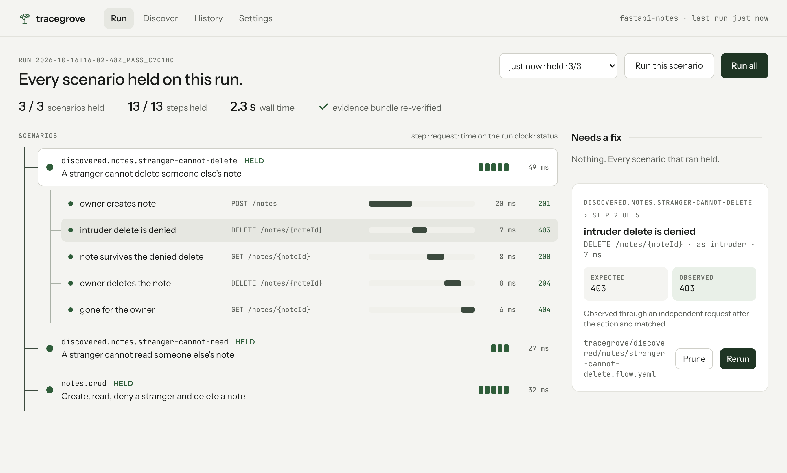

# tracegrove

**Behaviour tests your app has to actually pass, written by you or by a coding agent, with evidence anyone can re-verify.**

tracegrove starts your real FastAPI, Django or Node app, walks it through scenarios written as
short YAML files, checks every effect with an independent read, cleans up what it created, and
seals the whole run into a bundle that `verify-bundle` can re-derive byte for byte. Claude Code
or Codex can draft the scenarios from your routes and your intent, with explicit low-cost defaults,
and tracegrove re-checks everything they write before you see it.



## The 60-second tour

```text
npx --no-install tracegrove init                     # detect FastAPI / Django / Node, write a config and one example flow
npx --no-install tracegrove ui                       # the grove: run, discover, draft, history, settings
npx --no-install tracegrove draft --intent "a stranger can't read or delete someone else's note"
npx --no-install tracegrove test                     # run, verify, seal: .tracegrove/runs/latest/
```

The package remains private. Install a local packed archive before using the CLI examples;
use `npx --no-install tracegrove` to avoid resolving an unrelated registry package.

What makes it different:

- **Real app, real requests.** No mocks of your own code. Every step is an HTTP call to the app
  tracegrove launched for this run, on a free port with its own data dir and per-persona tokens.
- **Independent readback.** `observe: true` re-reads state through a separate request and polls
  until the expectation holds, so "the endpoint said 204" is never mistaken for "it's deleted".
- **Owned cleanup.** Fixtures are created through your API, read back, and deleted with a confirmed
  404/410, in reverse order, even when a scenario fails.
- **Evidence, not logs.** Each run is a sealed bundle with source digests, receipts and the frozen
  request. `verify-bundle` rehashes it and re-reduces the verdict on another machine.
- **Agents under the hood, never trusted blindly.** Claude Code or Codex writes drafts; tracegrove
  compiles them itself and only a real run produces a verdict.

## Quickstart: test your own app

Tracegrove drops into an existing FastAPI, Django or Node repo with one config file and one
YAML file per test. Those short files compile into the strict corpus described below, so every
run still gets attested source identity, independent readback, owned cleanup and a sealed,
re-verifiable evidence bundle.

```text
npx --no-install tracegrove init          # detects FastAPI / Django / Node, writes tracegrove.config.yaml + an example flow
npx --no-install tracegrove test          # compile, plan, run, verify; results in .tracegrove/runs/latest/
```

```yaml
# tracegrove.config.yaml
project: notes
app:
  adapter: fastapi            # node | fastapi | django | command
  entry: app.main:app
  sources: [app/**/*.py]      # bytes attested as "what was tested"
personas:
  owner: { subject: alice }   # the first persona is the default caller
  intruder: { subject: bob }
```

```yaml
# tracegrove/notes/crud.flow.yaml  ->  case id notes.crud
title: Create, read, deny a stranger and delete a note
steps:
  - name: create
    POST: /notes
    json: { title: Fresh note, body: hello }
    expect: 201
    save: { noteId: note.id }
  - name: read back
    GET: /notes/{noteId}
    observe: true             # independent readback, polled until expect holds
    expect: { status: 200, json: { note.title: Fresh note } }
  - name: intruder is denied
    GET: /notes/{noteId}
    as: intruder
    expect: { status: 403, absent: [note] }
```

Tracegrove picks a free port, passes it (and a fresh data directory and one random bearer token
per persona) to the app through `PORT`, `TRACEGROVE_DATA_DIR` and `TRACEGROVE_TOKENS`
(`{token: subject}` JSON), and waits on `app.health`. The app accepts those tokens in test mode;
`tracegrove init` prints the five-line snippet for the detected framework.

| `adapter` | launches |
| --- | --- |
| `node` | `node <entry>` |
| `fastapi` | `<python> -m uvicorn <entry> --host 127.0.0.1 --port {port}` (python: `.venv/bin/python`, else `python3`) |
| `django` | `manage.py migrate --noinput && manage.py runserver 127.0.0.1:{port} --noreload` in the `entry` folder |
| `command` | Reserved; BLOCKED until the application runtime can be independently observed |

Conventions:

- Flows live in `tracegrove/<area>/<behavior>.flow.yaml`; the case id is `<area>.<behavior>`.
- Fixtures live in `tracegrove/fixtures/<name>.fixture.yaml` and are used with `given: { alias: name }`;
  their saved values are `{alias.output}` in later steps. They are created through the API, read
  back independently and deleted with a confirmed 404/410 absence.
- `save: { name: dot.path }` makes `{name}` available to later steps; `expect.json` keys are dot
  paths into the response body. Prefer block style for anything containing `{` or `[` (or quote it).
- The effect envelope (methods, path prefixes, create budget) is derived from the steps.
- Each run writes `.tracegrove/runs/<UTC time>_<outcome>_<id>/` with `summary.md`, `summary.json`,
  `junit.xml`, the frozen `request.json` and the verified `bundle/`; `runs/latest` points at the
  newest. Add `.tracegrove/` to `.gitignore` (init does).
- Editor validation: point `yaml.schemas` at `schema/tracegrove_config_v1.json` and
  `schema/tracegrove_flow_v1.json`.

Runnable samples: `src/samples/notes-api` (Node), `src/samples/fastapi-notes`,
`src/samples/django-notes`. `tracegrove compile` writes the derived v1 corpus to
`.tracegrove/compiled/` if you want to inspect it or drop to the low-level commands.

## The grove: `tracegrove ui`

```text
npx --no-install tracegrove ui                          # current folder, working tree
npx --no-install tracegrove ui --dir ../api --branch feature/billing
```

A local page (bound to 127.0.0.1, with a per-session token on anything that writes), light and
dark, down to phone width:

- **Run.** Your scenarios as a bonsai: the trunk is the run, each branch a scenario, each twig a
  step with its request, its slice of the run clock and the observed status. Failures collect in
  **Needs a fix**; pick a step to see expected against observed and the evidence line. Run all,
  run one scenario, or switch to any earlier run.
- **Discover.** Pick the working tree or any git branch (read with `git show`, nothing is checked
  out). Routes from FastAPI decorators, Django `path()` and Express-style routers are listed with
  the flows that reach them, changed-on-this-branch first. Draft a skeleton for one route, or write
  what should be true in **Intent** and press **Draft with Claude**: the agent's work shows as named
  phases, and its flows arrive already checked, with **Run the new scenarios** one click away.
- **History.** A grid with one column per run and one row per scenario, so a single case's record
  and the whole set read at a glance. Any cell opens that run at that scenario.
- **Settings.** Choose Claude Code, Codex or none, and the model. Installed CLIs are detected.

**Pruning is a rename.** Prune a scenario and its file becomes `*.flow.yaml.pruned`: the compiler
skips it, the tree shows it as a dashed branch, and **Graft back** restores it. Nothing is deleted.

Discovery is a static heuristic that proposes tests; it is never evidence. Only `tracegrove test`
produces a verdict.

## Agents under the hood

tracegrove does not ship a model. It drives the coding agent you already use, headless:

| Provider | Command it runs | Default model |
| --- | --- | --- |
| `claude` (default) | `claude -p … --model claude-haiku-4.5 --permission-mode acceptEdits --allowedTools Read,Write,Edit,Glob,Grep,Bash(tracegrove check/list/discover)` | `claude-haiku-4.5` |
| `codex` | `codex exec --sandbox workspace-write --model gpt-6-luna` | `gpt-6-luna` |
| `none` | nothing; discovery and templates only | |

The agent gets the discovery report, your intent, the naming conventions, an existing flow as an
example, the persona names and the JSON Schemas. Its instructions request drafts under
`tracegrove/discovered/` and read-only checks; its CLI permissions remain the execution boundary.
After it exits, tracegrove lists changed flow files and compiles the project. Compilation is
not independent confirmation of the developer's intent. A configured `maxBudgetUsd` is
supported by the Claude adapter; Codex blocks that setting until enforced accounting exists.

Where the choice comes from, highest first:

1. `--agent` / `--model` on `tracegrove draft`
2. `.tracegrove/settings.json`, your own choice, written by **Settings** in the UI or `tracegrove settings --agent codex`
3. `agent:` in `tracegrove.config.yaml`, the team default:

   ```yaml
   agent:
     provider: claude      # claude | codex | none
     model: claude-haiku-4.5  # optional
     maxBudgetUsd: 0.50    # optional spend cap per draft (Claude Code)
   ```
4. The explicit low-cost defaults above. No inherited CLI model or silent provider fallback.

### Commands built for agents

Every one takes `--json`, and none starts your app:

```text
tracegrove discover [--branch <b>]   # routes vs. flows that reach them; changed files first
tracegrove check                     # compile only; exit 0 when clean, 2 with file:path-located issues
tracegrove list                      # flows with ids, tags and steps
tracegrove draft --intent "<what should be true>" [--agent claude|codex] [--model <m>]
tracegrove settings [--agent …] [--model …]
```

So any agent, including one you run yourself, can loop: `discover` → write flows → `check` →
`test` → read `.tracegrove/runs/latest/summary.json`.

## How it fits together

Prefer TypeScript? Use `tracegrove.config.ts` with `defineConfig`, `.flow.ts`
with `flow`, and `.fixture.ts` with `fixture`, all exported by
`workflow-verify/authoring`. These reuse the YAML validation and execution path.
See [typed authoring](docs/developer-ux.md#typescript-authoring) for examples,
module evaluation bounds, and supported TypeScript syntax.

```text
 tracegrove.config.yaml + tracegrove/**/*.flow.yaml + fixtures
        │  authoring compiler (src/authoring)
        ▼
 .tracegrove/compiled/  (strict workflow.*/v1 corpus, $file refs frozen to sha256)
        │  planner → admission + local ledger → executor
        │     hosts: local_process | mock_loopback   surface: http   fixtures: API create/readback/cleanup
        ▼
 trusted reducer → bundle writer → verify-bundle → .tracegrove/runs/<run>/
```

The everyday flow is `init` → `ui` or `draft` (discover, write with an agent, prune) → `test` → read the
run in the grove or with `show` → hand the bundle to anyone who runs `verify-bundle`.

What the adapters cover now and what's next:

| Area | Supported now | Next |
| --- | --- | --- |
| App launch | node, fastapi, django, any command; free port, data dir, per-persona tokens | `app.setup` commands (alembic, prisma, knex) |
| Seeding | Fixtures created through the app's API, read back, deleted with confirmed absence | SQL seeding, repo seed commands (factory_boy, Prisma seed), snapshots |
| Databases | SQLite via `TRACEGROVE_DATA_DIR` | `db: postgres` per-run database with `DATABASE_URL`, DB-state oracles, Redis/Mongo services |
| Async jobs | Separate-worker SQLite samples through HTTP or native Node IPC: persisted output, idempotency, cancellation, owner isolation | Independently supervised/attested Celery/RQ/BullMQ workers and broker services; hosted provider qualification |
| Third parties | Whole-app mock host for the contract lane (low-level corpus only) | Outbound interceptor (stub/record/pass-through per provider), record and replay, email/webhook capture |
| Data pipelines | None | `job` surface for dbt/Airflow/Dagster runs, table oracles (row counts, schema, golden files), DuckDB first |
| Browser | Typed short flows and low-level corpus, authenticated local personas, DOM/API assertions, sealed video and Grove playback | Staging qualification, trace/redaction collectors and controller-death cleanup |

The full gap analysis by layer, with priorities, is in [docs/architecture.md](docs/architecture.md).

## The verification core

This is the Phase 1a implementation of the plan in
`orgx/docs/architecture/workflow-verification-platform.md`. It is a prototype; nothing below is a
production claim.

What exists and is exercised by tests:

- Canonical JSON codec with shared vectors and SHA-256 self digests (`ref.digest` excluded).
- Strict versioned schemas (Zod 4) exported as JSON Schema under `schema/`, checked in sync.
- Project corpus loader: YAML/JSON beside the product source, `{ $file: ./path }` references
  frozen into exact refs, a frozen corpus manifest, digest-verified lookup.
- Compiler, planner (`plan` is side-effect free and returns blockers with owner and action),
  admission with idempotent redelivery, local single-writer ledger with stale-lock recovery.
- Executor: local process host with launcher-computed identity attestation and issued
  credentials, mock loopback host for the `mock_contract` lane, real HTTP driver with
  per-operation deadlines, registered fixture actions with independent readback and
  reverse-order cleanup, boundary observations, sealed receipts, trusted reducer.
- Evidence bundle writer and `verify-bundle`, which rehashes every file, rechecks every self
  digest, re-derives assertions from the frozen case and re-reduces the verdict.
- `tracegrove` CLI (also installed as `workflow-verify`): `init`, `test`, `list`, `show`, `compile`, `ui`, `discover`, `check`, `draft`, `settings`, `sample-config`, `validate`, `doctor`, `plan`, `cases`, `rerun`, `controller`, `seed --preview`,
  `run`, `inspect`, `export`, `verify-bundle`, `schema`. Exit codes 0/1/2/3/4.
- A real file-backed notes API sample with its corpus, plus an offline contract lane.

The local controller owns an exclusive ledger and accepts authenticated loopback commands
for one project. CLI runs delegate to that writer; concurrent redelivery reconciles the same
execution. Case lookup uses bounded pages with snapshot-bound cursors. `rerun` freezes a fresh
campaign while preserving case digests and original request lineage.

The POSIX local host uses a trusted supervisor with an IPC ownership channel. If
the controller is killed, the supervisor terminates the application process group
and removes its owned workspace. A process-kill test checks both effects. This
does not establish recovery after the supervisor itself is killed, distributed
fencing, or cleanup of external provider resources. Windows local launches are
blocked until a process-tree ownership implementation exists.

Bundle verification checks sealed required files, host capability records, target attestations,
fixture completeness and boundary observations. It rejects empty/traversal manifests and
producer resealing that removes required observations. This verifies portable integrity and
record consistency; the importer still needs its own issuer trust and access policy.
The [verified snapshot reader](docs/verified-bundles.md) supplies complete checked
records from the same bounded bytes used by the reducer, without rereading payloads.

`verifySourceCitation` checks exact repository/commit/path identity, document and
file digests, and inclusive line excerpt bytes through authorized trusted host ports.
It preserves UTF-8 and CRLF bytes, rejects traversal, unsupported files and unavailable
objects, and never falls back to the current checkout. These checks establish cited
source bytes. The source-analysis API connects them to runnable change elements and
the authenticated review policy; it does not establish passing product behavior.

The Phase 2 review API (`editPlan`, `reviewPlan`) binds exact source-plan
digests and scopes. Every specification edit clears its review. Concurrent edits and
reviews use a host-owned atomic compare-and-swap port; losing writes publish neither
review nor projection. Reviewer identity and policy come from authenticated host
admission. Tests exercise stale tokens, concurrent writers, resolver tampering and
denied authority. This API has no hosted store, execution-admission integration or
scenario activation. Resolving and validating source citations and coverage policy
are enforced through trusted source-analysis and policy ports before approval; hosted
implementations remain separate work. These records alone are not authority for product execution.
See [source-backed review](docs/source-review.md) for the immutable checks and atomic host contract.
`source-resolve` and `GitSourceReader` [freeze local Git commit pairs and full diffs](docs/git-source-resolution.md)
and read cited immutable objects after checkout changes. They supply source facts;
independent review policy, full source transport and runtime identity remain separate gates.
`LocalReviewStore` connects that API to the existing single-writer journal and preserves
reviews/source checks across reopen. [Local review storage](docs/local-review-store.md)
requires trusted host admission and source checking; it does not supply distributed authority.

Scenario qualification now has a typed registration/invalidation API with exact-matrix
and monotonic-history checks. It registers pending work and invalidates semantic edits;
it does not qualify or activate coverage. See [registration contract](docs/qualification-registration.md).
`reduceQualificationRound` binds an entire verified terminal campaign to the registered
cell/attempt allocations, retaining failed and mock evidence without granting a live
proof level. See [terminal result contract](docs/qualification-results.md) for the host authority boundary.
`LocalQualificationResults` retains those complete rounds through the existing immutable
result sink and supplies a durable replay-assessment index, with fresh issuer checks on reads.
`assessScenarioReplay` derives readiness from authenticated complete rounds, retains pending
and failed history, requires at least two independent live campaigns and checks the latest
admitted round. [Replay assessment](docs/replay-assessment.md) is read-only.
`activateScenario` rechecks that evidence and publishes an authenticated activation through
an atomic host port, with exact round selection and idempotent receipt recovery. See
[activation contract](docs/scenario-activation.md); hosted authority and activated regression execution remain open.
`LocalScenarioStore.activationPorts(results, authority)` publishes the active projection,
receipt and full assessment records together on the existing local ledger, after fresh
evidence and explicit owner authorization checks. Historical receipts cannot reverse invalidation.
`LocalScenarioStore` persists actual registration on the local ledger. The SDK's
`prepareQualificationExecution` and explicit runtime owner connect those admissions
to new executions using allocated cell identities, with current authority checks
before effects. See [registered execution](docs/qualification-registration.md#executing-a-registered-round).

`result-ingest --bundle <run/bundle> --sink <directory>` retains an independently
re-verified local bundle in the existing single-writer ledger and an immutable
archive. `results --sink <directory>` lists scoped receipts;
`results --sink <directory> --id <result-id>` freshly re-verifies a retained result
after the producer's directory is gone. The [result sink](docs/result-sink.md)
preserves failed and mocked outcomes, rejects conflicting deliveries, and never
treats storage acceptance as issuer authentication, qualification, or activation.

The optional [AWR delivery adapter](docs/awr-delivery.md) freezes a redacted report
and destination in that same ledger. `awr-prepare`, `awr-inspect`, and `awr-deliver`
separate preparation from authenticated import, retain failed product verdicts,
and retry the original key after a lost acknowledgement without rerunning tests.
Imported evidence remains unverified; native work acceptance is a separate gate.
The [work-report attachment stage](docs/work-report-attachment.md) links an imported
report to its original frozen work binding, rechecks hosted receipt identity, and
recovers lost attachment acknowledgements independently of import or execution.

The [local browser runner](docs/browser-driver.md) executes typed UI steps alongside HTTP
fixtures and independent readback, and verifies recordings in the portable bundle.
Browser short flows run through `tracegrove test`; Grove plays receipt-bound recordings
after rechecking the bundle. See the browser sample and guide for the exact syntax.
Still open: full runtime source selection,
hosted review and qualification, coordination acceptance, `seed --apply`, and distributed crash recovery.
Selected Git base/head trees can now be materialized into private independent
directories with `source-materialize`; the [source guide](docs/git-source-resolution.md#run-selected-revisions-independently)
shows running the same saved flow against each revision. `test --source-snapshot`
binds local launch content to the manifest: the supervisor verifies and copies the
pinned tree into its owned workspace. Automatic authenticated runtime revision
attestation remains open.
Agent drafting checks compilation; it does not confirm intended behavior or approve a plan.

## Zero-OrgX quickstart (low-level corpus)

```text
npm install && npm run build
node dist/cli/main.js sample-config --sample notes-api --output ./notes
node dist/cli/main.js doctor --config ./notes/verification/workflow.yaml
node dist/cli/main.js plan --config ./notes/verification/workflow.yaml --output ./out/request.json
node dist/cli/main.js run --request ./out/request.json
node dist/cli/main.js verify-bundle --bundle ./notes/verification/.workflow-verify/executions/<id>
```

No OrgX account, database, Docker, Python or model call is involved. The real sample's
proof claim is local application behavior at the attested source digest, not deployment.

To exercise asynchronous work, generate `sample-config --sample report-jobs --output
./reports`, then run `tracegrove test --config ./reports/tracegrove.config.yaml`.
The [report jobs sample](src/samples/report-jobs/README.md) uses a real separate worker
and persisted SQLite queue. Completion requires an independent output readback;
accepting a submission alone cannot pass. Its controlled missing-output defect
produces a sealed failed attempt. No model calls or external accounts are used.
For low-level commands, use the config path printed by sample generation.
For native `job.submit`, `job.observe`, and `job.cancel`, generate
`sample-config --sample report-native --output ./native-reports` instead.
The [native job bridge](docs/native-jobs.md) uses the same application, worker,
and storage with typed Node IPC requests and job observations. Hosted providers,
independent worker attestation and distributed crash recovery remain open.

For local MCP tools, install the pinned optional SDK and generate
`sample-config --sample notes-mcp --output ./mcp-notes`. The
[MCP protocol driver](docs/mcp-driver.md) uses the same planner, persona, evidence
and CLI path, with explicit tool/call limits and independent HTTP readback.
Protocol results do not qualify a widget host or mobile surface.

## Checks

For clean, credential-free Docker runs, see [container qualification](containers/README.md). Native real HTTP and offline contract lanes produce separate saved bundles.

```text
npm run verify            # typecheck, schema sync, unit and end-to-end tests
npm run test:conformance  # verifier conformance cases (refusals and non-green results)
```

## Repository provenance

This private repository was extracted with `git subtree split` from
`hopeatina/orgx:packages/tracegrove` at OrgX commit
`6da4205e0cef9fbd75b0e8e04cdfc6d5de669910`. The extracted bootstrap commit is
`92f163c49812e373bdb04550ea3771b278eab0cd`.

`codex/bootstrap` is the default branch. Releases are tagged on GitHub; v0.2.0 is the first,
with the authoring layer, the grove UI and agent drafting. The standalone sample installs a pinned package archive,
so its CI needs no cross-repository credential.
